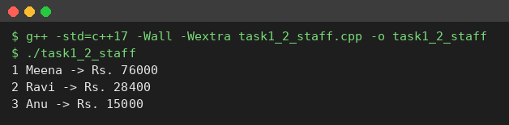
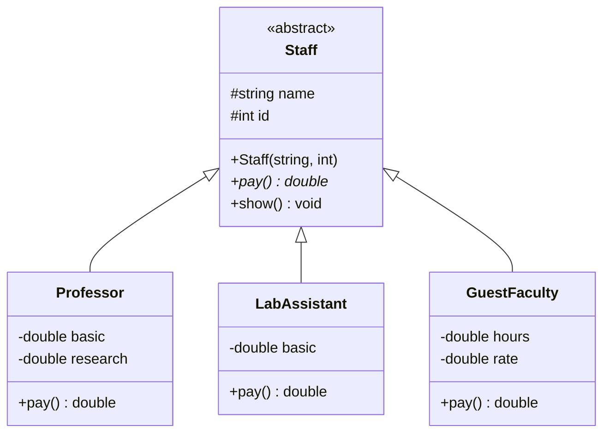
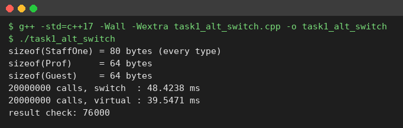

# Task 1 – Class Design Review (6 Marks)

## Task 1.1 – Diagnose the Design
| # | Deficiency | Where |
|---|-----------|-------|
| 1 | **Repeated fields** – `name`, `id`, `basic`, `da` are copied in every class | Professor, LabAssistant |
| 2 | **Repeated pay rule** – `basic + basic*0.42` is written twice | Professor, LabAssistant |
| 3 | **Public data members** – anyone can change salary or id directly (no encapsulation) | all 3 classes |
| 4 | **Inconsistent names** – `name/id` in two classes but `nm/code` in GuestFaculty for the same information | GuestFaculty |
| 5 | **Unused field** – `da` is stored but never used (the 42% is hard-coded instead) | Professor, LabAssistant |
| 6 | **Magic number** `0.42` – meaning unknown, must be edited in many places if DA changes | pay() |
| 7 | **No common type** – the three classes are unrelated, so all staff cannot be put in one array and processed in one loop | design |
| 8 | **Adding a new category** means copy-pasting a whole new class and changing every loop in the program | design |

## Task 1.2 – Repair the Design
Code: [`task1_2_staff.cpp`](task1_2_staff.cpp)  Output: 

`DA_RATE = 0.42` is one named constant. `pay()` is a pure virtual function in `Staff` and is overridden in each derived class.

## Task 1.3 – Design Defence (≤ 100 words)
Common data (`name`, `id`) and the `show()` function are written once in `Staff`. A new category, for example `VisitingScholar`, is just one new class that inherits `Staff` and overrides `pay()`. No existing class is edited, and the existing loop `for (Staff* s : list) s->show();` works for it automatically through virtual dispatch. The DA rate is a single constant, so a rule change is made in one place only. *(≈ 65 words)*

## Alternative Concept and Complexity Analysis
**Alternative:** one `StaffOne` class with a `type` field and `switch` in `pay()` → [`task1_alt_switch.cpp`](task1_alt_switch.cpp)

Output: 

| Point | Base class + derived classes | One class + switch |
|-------|------------------------------|--------------------|
| Time per `pay()` call | O(1) (one virtual call) | O(1) (one switch jump) |
| Measured, 20 million calls | see screenshot (≈ same) | see screenshot (≈ same) |
| Space per object | only the fields that category needs (64 bytes in my test) | **all** fields in **every** object, many unused (80 bytes) |
| Places to change for a new category | **1** – write one new class | **4+** – enum, `switch` in `pay()`, extra fields, constructor, and every other `switch` in the program |
| Existing code edited? | No | Yes (risk of breaking working code) |

**Conclusion:** both are O(1) in time; the hierarchy wastes less space and follows the open/closed principle (open for extension, closed for modification).
