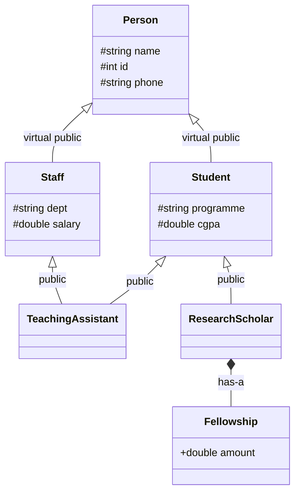
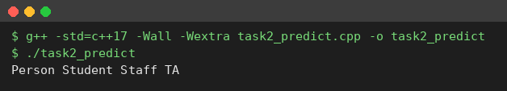
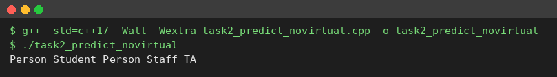
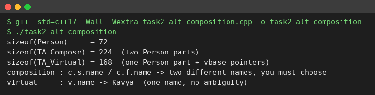

# Task 2 – From Requirement to Hierarchy (8 Marks)

## Task 2.1 – Identify the Relationships
| Relationship | Is-a / Has-a | Type of inheritance |
|--------------|-------------|---------------------|
| Student → Person | is-a | single |
| Staff → Person | is-a | single |
| Person → {Student, Staff} | – | **hierarchical** (one base, two derived) |
| TeachingAssistant → Student **and** Staff | is-a both | **multiple** |
| Person → Student → ResearchScholar | is-a | **multilevel** |
| ResearchScholar → Fellowship | **has-a** (member class) | composition |
| Whole design (Person, Student, Staff, TA) | – | **hybrid** (hierarchical + multiple = diamond) |

## Task 2.2 – Resolve the Diamond
`TeachingAssistant` inherits Student and Staff, and **both** inherit Person. Without `virtual`, a TA object contains **two** Person sub-objects (one through Student, one through Staff):
* `Person` constructor runs twice,
* memory is wasted,
* `ta.id` is **ambiguous** – the compiler cannot decide which copy is meant (see error below).

**Solution:** `class Student : virtual public Person` and `class Staff : virtual public Person`. Now the TA has **one shared** Person sub-object, created once (by the most-derived class), and `ta.id` is unambiguous.

Compiler error without virtual ([`task2_ambiguity.cpp`](task2_ambiguity.cpp)): 

## Task 2.3 – Design the Classes
Code: [`task2_design.cpp`](task2_design.cpp)  Output: 

**Inheritance mode:** every base is inherited **publicly** because every relationship is a true *is-a*. Protected/private inheritance would hide the base interface and a `TeachingAssistant*` could not be used as a `Student*` or `Person*`.

## Task 2.4 – Access Table (members of Person seen inside Student)
| Member of Person | public inheritance | protected inheritance | private inheritance |
|------------------|-------------------|----------------------|--------------------|
| **public** | public | protected | private |
| **protected** | protected | protected | private |
| **private** | not accessible | not accessible | not accessible |

(Private members are always inherited but never directly accessible in the derived class.)

## Predict the Output
Program: [`task2_predict.cpp`](task2_predict.cpp)

**My predicted output (written before running):** `Person Student Staff TA `

**Actual output:**   → **matches.**

**Why Person prints only once:** the virtual base `Person` is built **first and only once** by the most-derived class (`TeachingAssistant`). Then Student, then Staff (declaration order), then TA.

**Remove `virtual`** ([`task2_predict_novirtual.cpp`](task2_predict_novirtual.cpp)):

* **Predicted:** `Person Student Person Staff TA ` – each of Student and Staff builds its own Person.
* **Compiler messages:** none for this program (it is legal; the problem appears only when a Person member is used, then *"request for member is ambiguous"*).
* **Actual:** 

## Alternative Concept and Complexity Analysis
**Alternative:** TA *has-a* Student and *has-a* Staff (composition) → [`task2_alt_composition.cpp`](task2_alt_composition.cpp)

Output: 

| Point | Virtual inheritance | Composition (has-a) |
|-------|--------------------|---------------------|
| Person sub-objects | **1** | **2** (one inside each member) |
| `sizeof` (my test) | 168 bytes | 224 bytes |
| Reaching `name` | `v.name` – one name; time O(1) with one extra indirection through the virtual-base offset | `c.s.name` or `c.f.name` – two names, programmer must choose; O(1) direct, but the two copies can disagree |
| Ambiguity | none | none by syntax, but **duplicate data** |
| Is-a lost? | No – a TA can be used as Person*/Student*/Staff* | Yes – a TA is not a Student or a Staff type |

Space: O(1) per object in both, but composition stores Person data twice. Use inheritance when the object really *is a* student and staff; use composition when it only *uses* one.
