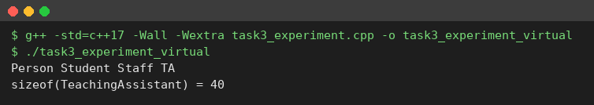
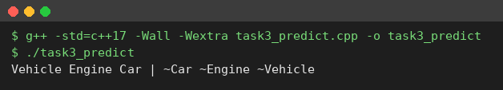
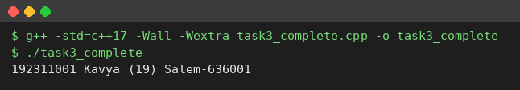
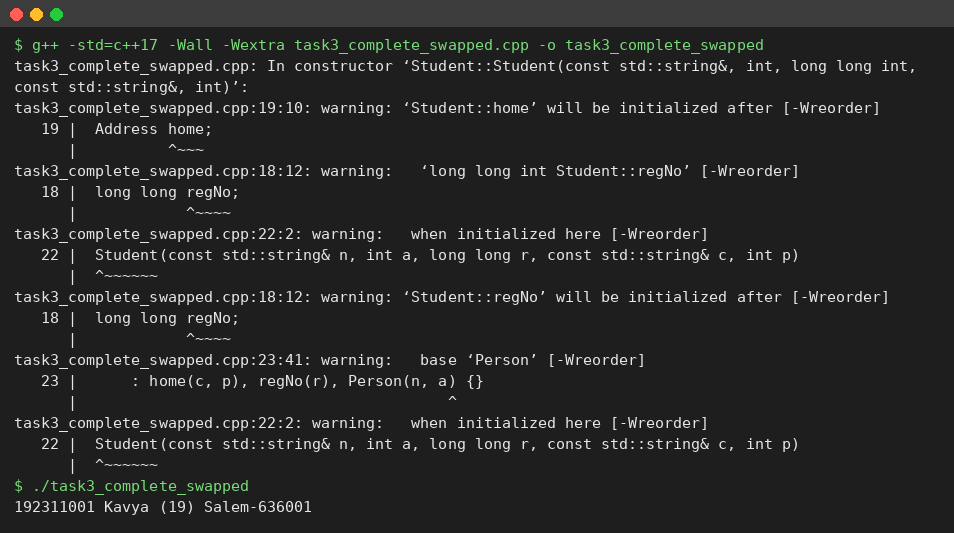

# Task 3 – Constructors in Derived Classes and Member Classes (9 Marks)

## Task 3.1 – Pass Values to Base Constructors   |   Task 3.2 – Member Classes
Code: [`task3_trace.cpp`](task3_trace.cpp)

```cpp
Person(const string& n, const string& city) : name(n), addr(city) {}                    // Address member gets city
Student(n, city, t)            : Person(n, city), course(t) {}                          // base + Course member
Staff(n, city, s)              : Person(n, city), salary(s) {}
TeachingAssistant(n, city, t, s): Person(n, city), Student(n, city, t), Staff(n, city, s) {}
```
**Why must the most-derived class call the virtual base constructor?**
`Person` is shared, so Student and Staff cannot both build it. If either did, the TA would get two different constructions. C++ therefore lets **only the most-derived class** (here `TeachingAssistant`) initialise the virtual base; the `Person(...)` calls inside Student's and Staff's lists are **ignored** when a TA is built. If the TA does not call it, the default constructor of Person is used (a compile error if Person has none).

## Task 3.3 – Trace the Order
Output: 

| Object | Construction | Destruction |
|--------|-------------|-------------|
| Student | Address, Person, Course, Student | ~Student, ~Course, ~Person, ~Address |
| Staff | Address, Person, Staff | ~Staff, ~Person, ~Address |
| TeachingAssistant | Address, Person, Course, Student, Staff, TA | ~TA, ~Staff, ~Student, ~Course, ~Person, ~Address |

**Rule:**
1. **Virtual base classes** first, then **non-virtual base classes** in the order written in the class header.
2. Then **member objects** in the order they are *declared* in the class (not the initializer-list order).
3. Then the body of the **derived class** constructor.
4. **Destruction is the exact reverse.**

## Task 3.4 – Experiment (remove `virtual`)
Code: [`task3_experiment.cpp`](task3_experiment.cpp) (compile once normally, once with `-DNOVIRTUAL`)

| | Output | sizeof(TeachingAssistant) |
|---|--------|---------------------------|
| with virtual | `Person Student Staff TA` | 40 bytes |
| without virtual | `Person Student Person Staff TA` | 32 bytes |




Without virtual, Person is built twice. It is smaller here only because Person is tiny (4 bytes) and the virtual version adds hidden virtual-base pointers. With a bigger Person (Task 2: 72 bytes) the virtual version is smaller (168 vs 224).

## Predict the Output
Program: [`task3_predict.cpp`](task3_predict.cpp)

**My predicted output (before running):** `Vehicle Engine Car | ~Car ~Engine ~Vehicle `

**Actual:**  → **matches.**

Rule: base `Vehicle` → member `Engine e` → body of `Car`; then reverse on destruction (`~Car` body, then member `~Engine`, then base `~Vehicle`). The `| ` is printed inside the block, between construction and destruction.

## Complete the Code
Code: [`task3_complete.cpp`](task3_complete.cpp)

TODO 1:
```cpp
Student(const std::string& n, int a, long long r, const std::string& c, int p)
    : Person(n, a), regNo(r), home(c, p) {}
```
Output: 

**Swap the order** ([`task3_complete_swapped.cpp`](task3_complete_swapped.cpp)): `: home(c, p), regNo(r), Person(n, a)`

Warning recorded (`-Wreorder`): *"'Student::home' will be initialized after 'long long Student::regNo' … base 'Person' … when initialized here"*



Reason: members are always initialised in **declaration order** (base first, then `regNo`, then `home`), whatever the order in the list. The program still runs, but the warning shows the written order is misleading.

## Alternative Concept and Complexity Analysis
**Alternative:** `Student` holds `Address* home = new Address(...)` → [`task3_alt_pointer.cpp`](task3_alt_pointer.cpp)

Output: 

| Point | Member object | Pointer to heap object |
|-------|--------------|------------------------|
| Extra time | none | one heap allocation `new` + `delete` – O(1) but slower than a stack/inline object |
| Extra space | 0 | 8 bytes for the pointer + the separate heap block (+ allocator overhead) |
| Constructor | initialiser list builds it | `home(new Address(c,p))` |
| Copy constructor | default is fine | **must write a deep copy** `new Address(*o.home)` – default copies the pointer and both objects would `delete` the same memory |
| Destructor | default is fine | **must** `delete home;` or memory leaks |

(Rule of three: if you need a destructor, you need a copy constructor and copy assignment as well.)
