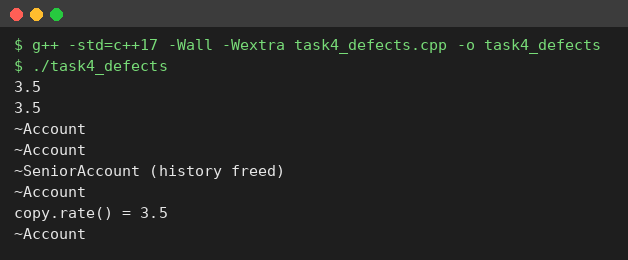
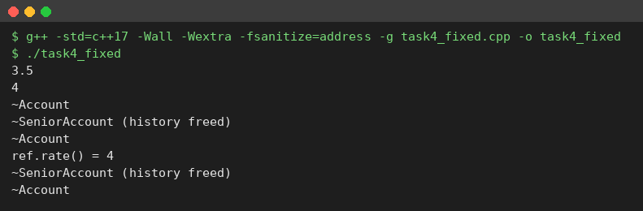
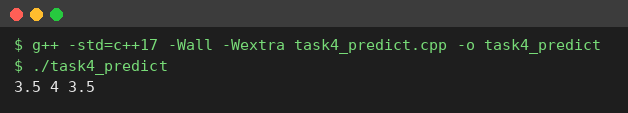

# Task 4 – Pointers to Derived Classes: Forensics (7 Marks)

## Task 4.1 – Locate the Defects
| # | Defect | Reason |
|---|--------|--------|
| 1 | Senior rate (4.0) never used | `rate()` is **not virtual**. `Account* a` calls `Account::rate()` at compile time. `SeniorAccount::rate()` only *hides* it, it does not override it. |
| 2 | Memory leak (the `history` array) | `~Account()` is **not virtual**. `delete a` on an `Account*` that points to a `SeniorAccount` only runs `~Account()`. `~SeniorAccount()` never runs, so `delete[] history` never happens (undefined behaviour). |
| 3 | `Account copy = SeniorAccount();` | **Object slicing** – only the `Account` part is copied. `copy` is a plain `Account`: the senior data/behaviour is cut off, so `copy.rate()` is 3.5. |

## Task 4.2 – Construct Evidence
Code: [`task4_defects.cpp`](task4_defects.cpp) (destructors print a message)

**Evidence from destructor messages** (no `-fsanitize`): 

* Both rates print `3.5` → defect 1.
* The two `delete a` lines print `~Account` twice and **`~SeniorAccount` never appears** → defect 2.
* The `~SeniorAccount` line that appears later belongs to the temporary object on the slicing line; `copy.rate() = 3.5` → defect 3.

**AddressSanitizer** (`-fsanitize=address -g`):
1. First it reports `new-delete-type-mismatch` – the object was deleted through the wrong type (no virtual destructor). 
2. With `ASAN_OPTIONS=new_delete_type_mismatch=0` it shows the actual **800-byte leak** (`new double[100]` in `SeniorAccount::SeniorAccount()`). 

## Task 4.3 – Repair the Program
Code: [`task4_fixed.cpp`](task4_fixed.cpp)  (compiled with `-fsanitize=address`, no error reported)

Changes: `virtual double rate()`, `override` in `SeniorAccount`, `virtual ~Account()`, and a **reference** `Account& ref = s;` instead of a copy.

Output:  – rates are `3.5` and `4`; both destructors now run, so `history` is freed.

## Task 4.4 – Prevent Recurrence (two rules)
1. **A base class with virtual functions must have a virtual destructor** (`virtual ~Account() = default;`).
2. **Write `override` on every function meant to override.** With `override` the compiler would have rejected `rate()` in `SeniorAccount` while `Account::rate()` was not virtual.

(Extra: pass/store polymorphic objects by pointer, reference or smart pointer – never by value.)

## Predict the Output
Program: [`task4_predict.cpp`](task4_predict.cpp)

**My predicted output (before running):** `3.5 4 3.5`

**Actual:**  → **matches.**

* `p->rate()` → **3.5** – `rate()` is not virtual, so the call is bound at **compile time** using the pointer type `Account*`.
* `p->vrate()` → **4** – virtual, bound at **run time** to the real object (`SeniorAccount`). (`4.0` prints as `4`.)
* `copy.vrate()` → **3.5** – `copy` is an `Account` object (sliced); its real type is `Account`, so even the virtual call ends in `Account::vrate()`.

## Alternative Concept and Complexity Analysis
**Alternative:** `std::vector<std::unique_ptr<Account>>` → [`task4_alt_unique_ptr.cpp`](task4_alt_unique_ptr.cpp)

Output: 

* **Time:** same, O(n) to process n accounts. **Space:** same, O(n) – a `unique_ptr` is the size of a raw pointer.
* The vector deletes every account automatically – no hand-written `delete`.
* **Defects that can still occur:** **all three.** `unique_ptr<Account>` still calls only `~Account()` if it is not virtual (leak); a non-virtual `rate()` is still never overridden; and slicing still happens if you write `Account c = *v[1];`. Smart pointers remove only "forgot to delete".
