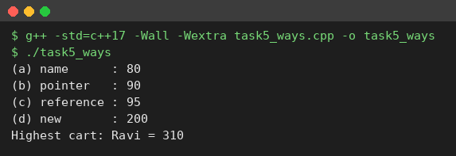
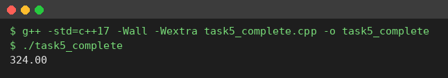

# Task 5 – Pointers to Objects and the `this` Pointer (7 Marks)

## Task 5.1 – Four Ways to Reach an Object   |   Task 5.2 – Array of Pointers
Code: [`task5_ways.cpp`](task5_ways.cpp)  Output: 

* (a) `a.add(50).add(30);` – by name; chaining works because `add()` returns `*this`.
* (b) `Cart* p = &a; p->add(10);` – pointer with `->`.
* (c) `Cart& r = a; r.add(5);` – reference.
* (d) `Cart* h = new Cart("Ravi"); h->add(200); delete h;` – heap object.
* `this->amount += amount;` – `this->` separates the member from the parameter with the same name.
* Task 5.2: `for (Cart** q = carts + 1; q < carts + 4; ++q) if ((*q)->total() > (*best)->total()) best = q;` – pointer arithmetic finds the highest total (Ravi = 310).

## Task 5.3 – Compare
| Way | Safety | Lifetime | Use when |
|-----|--------|----------|----------|
| (a) by name | safest, always valid | until the end of the scope | the object is local and used in one place |
| (b) pointer `->` | can be null or dangling | same as the object it points to | optional object, reseating, arrays of objects, polymorphism |
| (c) reference | cannot be null, cannot be reseated | same as the object | passing objects to functions without copying |
| (d) `new`/`delete` | risky: leak or double delete | **you** control it, until `delete` | object must outlive the scope or size is known only at run time (prefer `unique_ptr`) |

**Why is `this` a pointer?** Every non-static member function gets a hidden parameter `Cart* const this` that holds the **address** of the object on which the function was called. **`*this`** is that object itself (the cart that called `add`), so returning `*this` by reference returns the same object, not a copy.

## Complete the Code
Code: [`task5_complete.cpp`](task5_complete.cpp)

```cpp
Cart& add(const std::string& item, double price)
{ if (n < 10) { items[n] = item; prices[n] = price; ++n; } return *this; }

Cart& setDiscount(double discount)
{ this->discount = discount; return *this; }
```
Output:   → `324.00` ((60+120+180) × 0.90).

**What if `add()` returned `Cart` instead of `Cart&`?** (I tested it)
It returns a **copy**. In `c.add("Rice",60).add("Dal",120).setDiscount(10)` only the first `add` changes `c`; "Dal" and the discount are applied to temporary copies that are thrown away. The result becomes `240.00` (60 + 180, no discount) instead of `324.00`.


## Alternative Concept and Complexity Analysis
**Alternative:** `std::vector<Cart>` of objects → [`task5_alt_vector.cpp`](task5_alt_vector.cpp)

Output: 

| Point | Array of `Cart*` | `vector<Cart>` |
|-------|------------------|----------------|
| Time to find highest total | O(n) | O(n) (usually faster in practice: objects are contiguous in memory) |
| Space | one 8-byte pointer per cart + each cart on the heap | each Cart object is **copied** into the vector (40 bytes in the test) |
| Deleting | you must `delete` every cart | automatic |
| Pointers into it | stay valid (carts do not move) | **dangle when the vector grows** (it reallocates and moves the objects) – the test prints "no - it dangles!" |

## Viva – say it simply
* **`this`** = a hidden pointer to "the object that is calling me". `*this` = that object itself.
* **Chaining** works because `add()` returns `Cart&` (the same cart). Returning `Cart` would return a copy, so later calls change the copy, not your cart.
* **`->` vs `.`**: use `.` with an object or reference, use `->` with a pointer (`p->add()` is the same as `(*p).add()`).
* **`new` needs `delete`**, otherwise memory leaks.
* **Vector problem**: when a vector grows it moves its objects, so old pointers into it become invalid.
