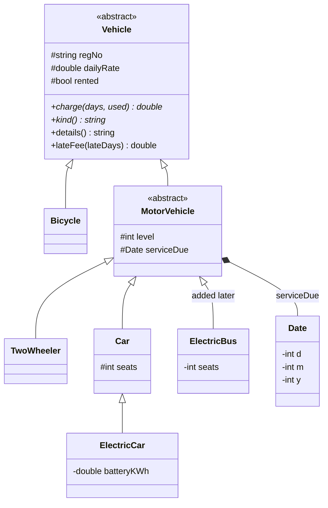
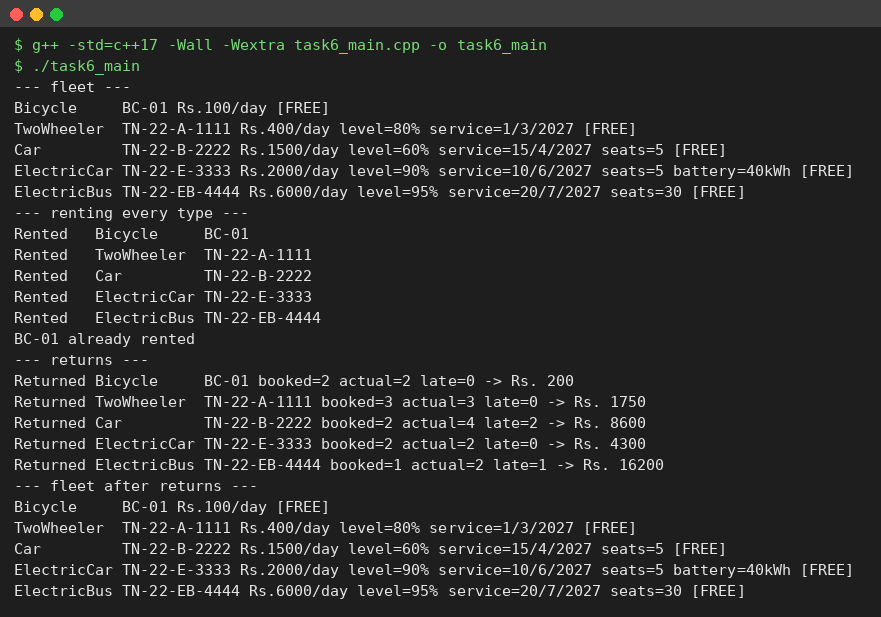
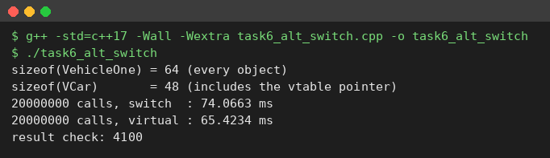

# Task 6 – Design Challenge: Vehicle Rental Fleet (13 Marks)

## Stage 1 – Interpret the Problem
**Entities and data**
| Entity | Data |
|--------|------|
| Vehicle (all) | registration number, daily rate, rented flag |
| Bicycle | – |
| Motor vehicle (two-wheeler, car, electric car) | fuel/charge level, service due date |
| Car | seating capacity |
| Electric car | battery capacity (kWh) |

**Behaviour that differs:** the rental charge. Bicycle = days × rate; two-wheeler and car = days × rate + litres × Rs.110; electric car = days × rate + kWh × Rs.12. Late return = Rs. 1.5 × daily rate per late day.

**Testable requirements**
1. R1: renting a free vehicle sets it to RENTED; renting an already-rented vehicle is refused.
2. R2: returning a vehicle sets it to FREE.
3. R3: Bicycle, 2 days, rate 100 → Rs. 200.
4. R4: Two-wheeler, 3 days, rate 400, 5 litres → Rs. 1750.
5. R5: Car, 2 booked days (returned after 4), rate 1500, 10 litres → 4100 + 2 × 2250 = Rs. 8600.
6. R6: Electric car, 2 days, rate 2000, 25 kWh → Rs. 4300.
7. R7: `list` prints every vehicle with its details and status.
8. R8: a new vehicle type can be added without editing any existing class.

## Stage 2 – Propose the Hierarchy

Inheritance type: **hierarchical** (Vehicle → Bicycle / MotorVehicle) and **multilevel** (Vehicle → MotorVehicle → Car → ElectricCar). All **public**. `Date` is a **member class**.

## Stage 3 – Critical Design Decisions
| Decision | Choice |
|----------|--------|
| In `Vehicle` | regNo, dailyRate, rented flag, `lateFee()` (same for all) |
| In `MotorVehicle` | level, service due date (`Date` member), `fuelCost()` helper |
| In `Car` / `ElectricCar` | seats / battery capacity |
| Pure virtual | `charge(days, used)` and `kind()` – every type must supply its own |
| Other virtual | `details()` (each class adds its own data), virtual destructor |
| Not virtual | `lateFee()`, `isRented()`, `reg()` – same for every vehicle |
| Fleet storage | `Vehicle* fleet[N]` – an array of base-class pointers, loop calls virtual functions |

## Stage 4 – Design the Classes
Code: [`Vehicles.h`](Vehicles.h) (all classes) and [`ElectricBus.h`](ElectricBus.h) (new type)

**Pseudocode – rent a vehicle** *(adapt the layout to the SIMATS pseudocode standard given in your course)*
```
ALGORITHM RentVehicle
INPUT : v – pointer to a Vehicle
OUTPUT: true if rented, false otherwise
BEGIN
  IF v.rented = TRUE THEN
      PRINT "already rented"
      RETURN false
  END IF
  v.rented ← TRUE
  PRINT "Rented", v.kind(), v.regNo
  RETURN true
END
```
**Pseudocode – return a vehicle**
```
ALGORITHM ReturnVehicle
INPUT : v, bookedDays, actualDays, used (litres or kWh)
OUTPUT: bill amount
BEGIN
  late ← 0
  IF actualDays > bookedDays THEN late ← actualDays − bookedDays END IF
  bill ← v.charge(bookedDays, used) + v.lateFee(late)   // virtual call: correct rule for each type
  v.rented ← FALSE
  PRINT bill
  RETURN bill
END
```

## Stage 5 – Implement and Demonstrate
Code: [`task6_main.cpp`](task6_main.cpp) – includes `Vehicles.h` and `ElectricBus.h`.

Output: 

Demonstrated: renting every type, a refused double-rent, returns on time (bicycle, two-wheeler, electric car), returns **late** (car: 2 days late → Rs. 8600; electric bus: 1 day late → Rs. 16200), and the new **ElectricBus** (new file, **no existing class edited**; only `main` creates one and includes the header).

## Alternative Concept and Complexity Analysis
**Alternative:** one `Vehicle` class with a type code and `switch` in `charge()` → [`task6_alt_switch.cpp`](task6_alt_switch.cpp)

Output: 

| Point | Abstract base + virtual functions | Single class + switch |
|-------|-----------------------------------|-----------------------|
| Time per `charge()` | O(1) – one virtual call (vtable lookup) | O(1) – one switch jump (measured: about the same) |
| Space per object | only the data its type needs **+ one vtable pointer (8 bytes)** | every object carries **all** fields (level, seats, battery…), unused for some types |
| Classes changed to add a new type | **0 existing** – write 1 new class | **1 existing class edited** – enum, `switch`, fields, and every other `switch` (print, details) |
| Risk | none to old types | a mistake can break rentals of every existing type |

*Note on the measured sizes:* `VehicleOne` is 64 bytes for **every** object; the test class `VCar` (48 bytes) is minimal. Real hierarchy objects are larger (e.g. `ElectricCar` has seats, level, date and battery) but a Bicycle stays small, whereas in the single class a bicycle always costs 64 bytes.

## Viva – say it simply
* **Abstract class** = a class with at least one pure virtual function (`= 0`); you cannot create an object of it, only use it as a base. Here: `Vehicle` (and `MotorVehicle`).
* **Why a base-class pointer array?** `Vehicle* fleet[5]` holds every type; the loop calls `charge()` and the **right version runs automatically** (run-time polymorphism).
* **Why virtual destructor?** So `delete v` on a `Vehicle*` also destroys the derived part.
* **How was ElectricBus added without changing old classes?** It is a new class in a new file that inherits `MotorVehicle` and overrides `charge()`. Nothing else needed editing (open/closed principle).
* **Member class**: `Date` is a member of `MotorVehicle` (has-a, composition).
* **Late charge**: `lateFee()` is the same for all vehicles, so it is a normal function in the base class.
